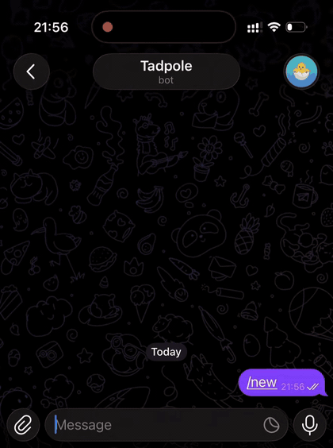

# Tadpole

[](https://github.com/shakewingo/Tadpole/actions/workflows/tests.yml)
[](https://colab.research.google.com/github/shakewingo/Tadpole/blob/main/agent_from_scratch/examples/walkthrough.ipynb)
[](LICENSE)
[](https://huggingface.co/Shakewin)

*An LLM agent built from scratch, and grown one stage at a time.*

<p align="center">
  
</p>

A tool-using agent in about 3,500 lines of plain Python, with no agent framework, that you can
run around the clock from Telegram, and a stage-by-stage record of how it was built, measured
and post-trained.

- **An agent you can use.** Files, shell, web search and fetch, sessions and compaction, on a
  local 4B model or any OpenAI-compatible API, in a terminal or as a Telegram bot.
- **A from-scratch tutorial.** Each stage adds one mechanism with tests and measured evidence,
  from the first agent loop to SFT, expert iteration and a GRPO pilot. Post-training lifts
  Qwen3-4B from **0.419 to 0.774** pass@1 on task types it never trained on
  ([results](#post-training-results)).

## Use the agent

### Install

Python 3.11 or later. Run every command from the repository root with the venv active.

```sh
git clone https://github.com/shakewingo/Tadpole.git
cd Tadpole
python3 -m venv .venv && source .venv/bin/activate
pip install -e .
```

### Choose a model

Use a strong model through any OpenAI-compatible API: DeepSeek, OpenAI, OpenRouter, or your own
vLLM or LM Studio server. `export` these for the terminal, or put them in the
[bot's env file](agent_from_scratch/deploy/telegram-bot.env.example):

```sh
export AGENT_BASE_URL=https://api.deepseek.com   # the API root; often ends in /v1
export AGENT_MODEL=deepseek-flash                # the provider's model ID
export AGENT_API_KEY=sk-...
export AGENT_N_CTX=32768                         # optional: the model's context window
```

<details>
<summary><b>Run Qwen3-4B locally, base or post-trained</b>: the model this project trains, for
studying the training rather than everyday use</summary>

| Option | Variables |
|---|---|
| Ollama, any OS | `AGENT_BASE_URL=http://localhost:11434/v1`, `AGENT_MODEL=hf.co/unsloth/Qwen3-4B-Instruct-2507-GGUF:Q4_K_M`, `AGENT_N_CTX=32768` |
| llama.cpp in-process, macOS; Qwen2 or Qwen3 GGUFs | leave `AGENT_BASE_URL` unset; `AGENT_MODEL_PATH` defaults to `models/Qwen3-4B-Instruct-2507-Q4_K_M.gguf` |
| A Tadpole [adapter](#download-the-adapters-and-data) on llama.cpp, macOS | `AGENT_MODEL_PATH=models/Qwen3-4B-Instruct-2507-Q8_0.gguf`, `AGENT_LORA_PATH=models/ei-3-lora-f16.gguf` (or sft-1, sft-2); planning turns off, as in training |

```sh
# Ollama: pull, then serve with a window large enough for the agent
ollama pull hf.co/unsloth/Qwen3-4B-Instruct-2507-GGUF:Q4_K_M
OLLAMA_CONTEXT_LENGTH=32768 ollama serve

# llama.cpp: the default AGENT_MODEL_PATH
hf download unsloth/Qwen3-4B-Instruct-2507-GGUF Qwen3-4B-Instruct-2507-Q4_K_M.gguf --local-dir models

# An adapter, on the Q8_0 base it was measured on
hf download unsloth/Qwen3-4B-Instruct-2507-GGUF Qwen3-4B-Instruct-2507-Q8_0.gguf --local-dir models
hf download Shakewin/tadpole-qwen3-4b-ei-3 ei-3-lora-f16.gguf --local-dir models
```

llama.cpp keeps the model in memory while the agent runs: about 8.5 GB for the Q8_0 base with its
32k window, which slows a 16 GB Mac.

</details>

### Chat in the terminal

```sh
python -m agent_from_scratch.agent
```

### Chat from Telegram

1. Message [@BotFather](https://t.me/BotFather) with `/newbot` for a **bot token**, and
   [@userinfobot](https://t.me/userinfobot) for your numeric **user ID**.
2. Put both, and your `AGENT_*` variables if you use an API, in the env file:

   ```sh
   cp agent_from_scratch/deploy/telegram-bot.env.example agent_from_scratch/deploy/telegram-bot.env
   ```

3. Start it, and message your bot: `sh agent_from_scratch/scripts/run_telegram_bot.sh`

> [!WARNING]
> The agent runs shell commands and edits files with your user's permissions. It answers only
> `TELEGRAM_ALLOWED_USER_ID`, but anyone with the token controls the bot: keep the env file private.

In Telegram and the terminal: `/new` starts a session, `/reset` clears it, `/session <id>`
switches to a named one, and `/compact` summarizes the history.

### Keep it running 24/7

Use an always-on machine: a Mac that does not sleep, a home server, or a small cloud VM with an
API model (1 GB is enough).

```sh
# Linux (systemd)
UNIT=~/.config/systemd/user/tadpole-bot.service
mkdir -p "$(dirname "$UNIT")" && cp agent_from_scratch/deploy/tadpole-bot.service "$UNIT"
sed -i "s|/REPLACE/WITH/REPO/PATH|$PWD|g" "$UNIT"
systemctl --user enable --now tadpole-bot && sudo loginctl enable-linger "$USER"

# macOS (launchd); also turn on "Prevent automatic sleeping when the display is off"
PLIST=~/Library/LaunchAgents/com.tadpole.telegram-bot.plist
cp agent_from_scratch/deploy/com.tadpole.telegram-bot.plist "$PLIST"
sed -i '' "s|/REPLACE/WITH/REPO/PATH|$PWD|g" "$PLIST"
mkdir -p outputs && launchctl load "$PLIST"
```

Logs: `journalctl --user -u tadpole-bot -f` on Linux, `outputs/telegram_bot.log` on macOS.

## Learn how it was built

Each stage adds one mechanism, with a deliberate failure, focused tests (601, none needing a
model) and evidence from real model runs.

| Stage | What you build | Code | Read and run |
|---|---|---|---|
| 0.5 | One request: model → tool call → result → answer, with validated calls and errors fed back | `llm.py`, `agent.py`, `tools/base.py` | [notebook §1](agent_from_scratch/examples/walkthrough.ipynb) |
| 1 | Multi-turn sessions, structured traces, explicit stop reasons | `session.py`, `trace.py` | notebook §2 |
| 2 | Files, shell, web search and fetch tools behind one registry | `tools/` | notebook §2 |
| 3 | Context budgeting, compaction, a summary checkpoint that survives restart | `context.py`, `compact.py` | notebook §3 |
| 8 | A generated benchmark, an independent verifier, a frozen protocol | `evals/bench/` | notebook §4, [datasets](agent_from_scratch/evals/README.md#datasets), [add a task type](agent_from_scratch/evals/README.md#adding-a-task-type) |
| 9 | SFT: verified trajectories → examples → LoRA adapter | `evals/sft/` | notebook §5–6, [SFT data](agent_from_scratch/evals/README.md#building-sft-data), [training](agent_from_scratch/evals/README.md#training-an-adapter) |
| 10 | Expert iteration and a GRPO pilot | `evals/sft/grpo.py` | notebook §7, [EI and GRPO](agent_from_scratch/evals/README.md#expert-iteration-and-grpo) |
| 11 | One final comparison on held-out tests | `evals/report.py` | [results](agent_from_scratch/docs/results.md) |

Start with **[the walkthrough notebook](agent_from_scratch/examples/walkthrough.ipynb)** (outputs
saved, so it reads on GitHub), then **[the build log](agent_from_scratch/docs/STAGE.md)** for
each stage's evidence and **[evaluating and post-training](agent_from_scratch/evals/README.md)**
to run it yourself. Training needs a 24 GB CUDA GPU; the whole post-training line cost about
\$140 on RunPod.

## Post-training results

The agent's code, prompts and tools were frozen, with planning off (no `update_plan` tool); only
the weights changed. Every choice was made
on val, and each final model ran once on two held-out sets whose task types no training set
contains: 140 single-turn tasks (test) and 80 leveled tasks (hard test), three samples each.

| | Base | SFT-1 | SFT-2 | EI-3 |
|---|---:|---:|---:|---:|
| Test pass@1 | 0.419 | **0.774** | 0.738 | *0.745* |
| Test pass^3 (all three samples pass) | 0.364 | **0.707** | 0.607 | *0.657* |
| Hard test pass@1 | 0.275 | 0.429 | **0.492** | *0.471* |
| Hard test pass^3 | 0.125 | 0.250 | *0.325* | **0.338** |
| BFCL multi-turn† | *0.360* | 0.285 | 0.325 | **0.395** |

**Bold** is best, *italic* second. SFT-1: verified teacher trajectories plus When2Call and Toucan
rows. SFT-2: plus multi-turn demonstrations. EI-3: SFT-2 after three rounds of expert iteration.
† A local adaptation of BFCL's multi-turn base category, not a leaderboard score.

- **SFT on verified demonstrations gives the large gain**, and false "done" claims fall from 31
  to 1 in 420 runs.
- **The three post-trained models are level on held-out tasks** (0.648, 0.648, 0.645 over all
  220); EI-3 is the most balanced, and beats SFT-2 on BFCL (p = 0.034).
- **Val overstated expert iteration** (0.752 → 0.852), and **GRPO lost to it** at equal rollouts.
  Neither learned a behaviour the model never produced.

One training run per model, on a small local benchmark: not a claim about general agent ability.
Full tables, paired tests and limitations: [docs/results.md](agent_from_scratch/docs/results.md).

### Download the adapters and data

Download all adapters and training data from [Hugging Face](https://huggingface.co/Shakewin).
Each card includes serving or data-reproduction instructions.

## Roadmap

- **Memory** across sessions, with remember, search and forget tools.
- **Skills and MCP** behind the same tool registry.
- **Background jobs** for the always-on bot, and a read-only sub-agent.
- **A self-improving harness**: with the model fixed, let execution feedback improve the prompts
  and tools.

Details: [the build log](agent_from_scratch/docs/STAGE.md#what-comes-next).

## Acknowledgements

The tool implementations adapt parts of [nanobot](https://github.com/HKUDS/nanobot)
([attribution](agent_from_scratch/tools/THIRD_PARTY.md)). Thanks to the authors of
[Qwen3](https://huggingface.co/Qwen/Qwen3-4B-Instruct-2507),
[When2Call](https://huggingface.co/datasets/nvidia/When2Call),
[Toucan](https://huggingface.co/datasets/Agent-Ark/Toucan-1.5M) and
[BFCL](https://github.com/ShishirPatil/gorilla).

## License

[MIT](LICENSE), Copyright (c) 2026 shakewingo. Third-party material keeps its own license (the
nanobot tools MIT, the Qwen-derived chat template Apache-2.0), and the Hugging Face adapters are
Apache-2.0, the SFT data MIT; see [Third-party notices](THIRD_PARTY_NOTICES.md).
