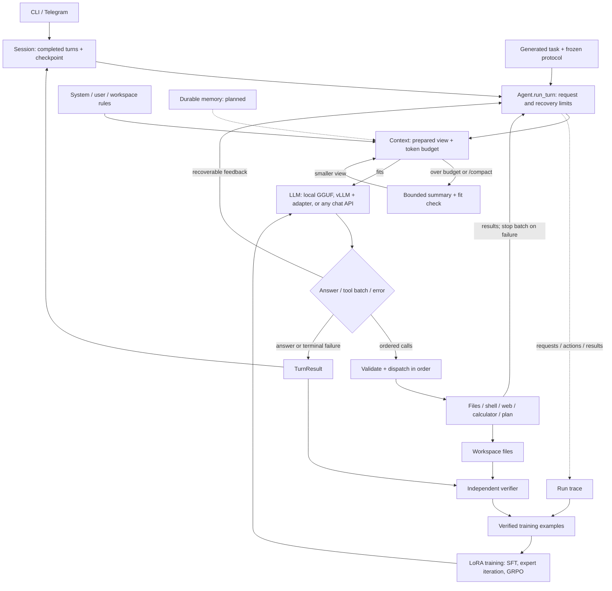

# Build log: a tiny agent, from the loop to post-training

This is the plan the project followed, stage by stage: what each stage set out to build, what was built, what the evidence showed, and where the build
departed from the plan. Results tables are in [results.md](results.md); the datasets are
described in [evals/README.md](../evals/README.md#datasets).

## Goal

Learn, by building it, how an agent's loop, tracing, error recovery, context management and
post-training change what it can do. Two deliverables:

- **A working agent**: multi-turn conversations with replayable sessions, local file, shell and
  web tools, dependent tool calls, traceable actions and results, bounded recovery from common
  errors, and long conversations that compact and continue, also after a restart.
- **A post-training experiment**: change a trainable model's weights, reload it into the same
  agent, and test on a reproducible benchmark whether it became a better agent. Report failures
  and regressions as plainly as gains. Better prompts alone do not count.

**The model.** Every command and every reported number uses
[Qwen3-4B-Instruct-2507](https://huggingface.co/Qwen/Qwen3-4B-Instruct-2507): locally as a GGUF
through llama.cpp, and in bf16 on vLLM for every measured result. A 4B model fails often enough
to leave room for training, and training and RL fit a small budget. The agent also runs on any
OpenAI-compatible model. (Stages 0.5–3 were first developed against a Qwen2.5-7B GGUF, before
the project chose a model it could train; nothing in them depends on that model.)

### Rules

- Ordinary functions and dataclasses, the standard library where practical. No agent
  framework, event bus, provider catalogue or UI project.
- The loop, context, tracing, tool boundaries and training-data logic are written by hand; AI
  helps with review, fixtures, boilerplate and debugging, and later stages delegate more code
  to it, recorded per stage.
- Tool calls arrive in ordered batches, run one after another, and stop at the first failure;
  arguments that depend on a result wait for it.
- Each stage leaves a small demo, a deliberate failure, and evidence of what changed. Unit
  tests cover state and side effects; real-model runs measure capability; the two kinds of claim
  stay separate.
- Keep the core small: about 1,500–2,000 lines was the target and 3,000 the alarm. The core
  (top-level runtime modules and `tools/`) was 1,515 lines after Stage 2, 2,800 after Stage 3,
  and is about 3,300 today. Audit it with
  `python -m agent_from_scratch.evals.core_lines HEAD`.

### Stages

| Stage | Status | Output |
|---|---|---|
| 0.5 — one request with an agent loop | complete | model → tool → observation loop, validated calls, errors fed back |
| 1 — sessions and observable execution | complete | multi-turn sessions, structured traces, explicit stop reasons |
| 2 — files, shell and web tools | complete | a general tool set behind one registry |
| 3 — context and compaction | complete | a token budget before every request, compaction, a restartable summary checkpoint |
| 4 — durable memory | deferred | — |
| 5–7 — skills and MCP, background jobs, a child agent | optional, not built | — |
| 8 — benchmark and harness freeze | complete | generated tasks, an independent verifier, a frozen protocol, the base model's baseline |
| 9 — supervised fine-tuning | complete | LoRA adapters chosen on val, tested once: 0.419 → 0.774 |
| 10 — expert iteration and a GRPO pilot | complete | three self-training rounds and a GRPO pilot at equal sampling |
| 11 — final comparison | complete | every final model once on test, a hard test and two external benchmarks |

## Stage 0.5 — one request with an agent loop · complete

- [x] Local inference, response parsing, tool dispatch and a calculator. One user request can
  take several model → tool → observation iterations before a final answer.
- [x] Validate the response structure and tool arguments before running anything; return parse
  and tool errors to the model as feedback, with a bounded number of requests.
- [x] Extract native and Qwen-style call batches with their surrounding narration; keep quoted
  examples as text. Validate every call before running any; at most 8 calls per response and
  40 per turn.
- [x] Trace each call and result, including calls skipped after a failure, an interruption or an
  exhausted budget.
- [x] Data model: `LLMResponse`, `ResponseError`, `ToolResult`/`ToolErrorCode`, `TurnResult`.

**Capability gained:** tool use within one request.

## Stage 1 — multi-turn sessions and observable execution · complete

The execution of one turn and the replay of a conversation are separate concerns: the loop runs
a turn, and the session store decides what a later turn sees.

- [x] Conversation persists across turns; `/new`, `/reset`, `/session <id>`. `run_turn` takes
  history explicitly; the REPL loads completed turns from disk.
- [x] Structured **session → run → model request / tool result** records: IDs, ordered
  messages, raw responses, errors, stop reason, settings, elapsed time and usage. Call IDs join
  requests to results.
- [x] Explicit stop reasons: `final_response`, `max_iterations`, `tool_limit`, `no_progress`,
  `model_error`, `interrupted`. Three identical consecutive failures stop the loop; Ctrl-C keeps
  the evidence gathered so far.
- [x] Only completed turns are replayed. Failed and interrupted runs stay in the trace as
  evidence.

**Boundary:** saved at turn end by a single writer; no exact mid-turn crash resume. A final
answer does not prove the task succeeded: stopping too early is a model gap measured later.

## Stage 2 — files, shell and web tools · complete

The lifecycle of a call stays explicit: **parse → registry and schema validation → execution
policy → execute → result or error → next iteration**. Prompt rules describe the expected
behaviour; the runtime enforces paths, allowed operations and budgets.

- [x] A registry per agent, with schemas generated from it. `tools/files.py`: recursive,
  paginated `list_files`, line-numbered `read_file`, full or append `write_file`, targeted
  `edit_file`, atomic replacement; PDF and Office text through `file_documents.py`.
- [x] `tools/web.py`: `web_fetch` with main-content extraction, bounded time and size, and
  `web_search`. Pages are untrusted evidence.
- [x] `tools/shell.py`: ordinary commands with exit code, capped output and timeout, and process
  groups cleaned up on timeout or Ctrl-C. The shell runs with the user's permissions; file-tool
  bounds do not sandbox it.
- [x] Denials and failures are visible as `ToolResult`s in the same trace. An interrupted call
  is recorded as interrupted, never as succeeded, and never replayed automatically.

**First behavioural check.** A 17-task hand-written suite (dependent inspection, constrained
edits, recovery, stopping) drove the first prompt fixes and exposed the gaps the benchmark later
measured: nested edits, recovery after a failed fetch, exact answer formats, and false "done"
claims. It was retired once Stage 8's generated benchmark covered the same families.

## Stage 3 — context construction and compaction · complete

### 3A — one prompt path and a visible budget

- [x] `context.py`: one builder runs before every generation, including after tool results and
  parser feedback. The model sees a prepared copy; the raw messages keep every exchange for
  traces, sessions and evaluation.
- [x] `prompts/system.md` in four parts (purpose, behaviour, tools, reporting). Rules load in a
  fixed order (system → user file → workspace `AGENTS.md`) with size caps and visible errors
  instead of silent truncation.
- [x] Count the real formatted prompt (schemas and role markers included) with the model's own
  tokenizer, and record prompt tokens, window, reserve and room in every request trace.
- [x] Require `prompt + response reserve + margin <= window` before every generation; otherwise
  stop with `context_limit`. Nothing is silently truncated.

### 3B — compact and continue the same task

- [x] One compaction path (`compact.py`), automatic under pressure or requested with
  `/compact`. The summary keeps goal, constraints, progress, errors and corrections, and next
  steps; the instructions, the current request, the two most recent tool batches and every
  observation not yet sent stay verbatim. A call and its result are never split.
- [x] Two thresholds: old bulky tool outputs are stubbed at 60% of the usable window, and a
  summary is made at 85%. The candidate view is measured again before it is used.
- [x] Rules reload at the compaction boundary. Run ID, counters, registry and workspace state are
  untouched; summarized file state is to be reread, not trusted.
- [x] Bounded: at most two summary calls per attempt and four per run, charged to the request
  limit. A failed or still-too-large summary keeps the raw evidence and stops with
  `context_limit`.

### 3C — persist and inspect the continuation

- [x] A versioned summary checkpoint in the session file, written after the raw turn it covers.
- [x] On restart, replay the summary plus the raw messages after it; an invalid or stale
  checkpoint falls back to raw history. `/reset` clears it.
- [x] Traces record what each request actually sent, its purpose (`agent` or `compact`), and the
  sizes before and after.

**Evidence.** Deterministic tests cover pressure right after a tool result and after a parser
error, a failing summarizer, a failed checkpoint write and a restart. A separate pressure suite
(4 tasks over 9 files of about 15k characters) compares context management on and off
(`evals pressure`). The walkthrough notebook's section 3 compacts and resumes a live session.

## Stage 4 — durable memory · deferred

Planned: a bounded memory index with on-demand detail, explicit remember / search / read /
forget tools, provenance and corrections, and recall in a fresh session. Deferred so that the
benchmark and post-training could proceed; the benchmark freezes `memory: off`, so
no result below depends on it. It is the first item of [what comes next](#what-comes-next).

## Stage 8 — benchmark and harness freeze · complete

The task sets: [evals/README.md, "Datasets"](../evals/README.md#datasets).

- [x] Four task families (inspection, updates, recovery, stopping), each task needing about 2–6
  dependent tool calls. Tasks are generated from **task types**: each type varies layout,
  distractors, values and fault positions by seed, and any valid tool path passes.
- [x] Train, val and test are split by type before any task is generated: 8 val types (64 tasks)
  and 10 test types (60 tasks), the test types fixed before any was implemented.
- [x] An independent verifier checks final files, the answer, what was read and what must stay
  unchanged, and flags **false completion**: a reply that claims done while the checks fail.
  Every type's scripted solution passes, and answering without reading fails.
- [x] A **freeze** (`evals/bench/manifest.py`) records source, prompts, chat template, limits,
  compaction policy, `memory: off`, splits, the verifier, and the protocol: Qwen3-4B-Instruct-2507
  at a pinned revision in bf16 on vLLM, the model card's sampling (temperature 0.7, top-p 0.8,
  top-k 20), three seeds per task, a 32k window. `bench --final` refuses to run on any drift.
- [x] The vLLM path renders the project's chat template itself, so training examples can later be
  exported token for token as the model saw them.
- [x] **Baseline** on one rented A40 (\$0.35): token measurement exact on all 1,496
  requests; val pass@1 0.542; test 0.667, with stopping at 0.00 on test.

A pipeline pilot before the freeze found one harness cause behind most update and stopping
failures: the model copied `read_file`'s `N| ` line-number prefixes into its writes, and a
broken JSON write still returned `ok`. Tool descriptions now forbid the prefixes, a `.json` write
that does not parse is refused, and every editing type offers `edit_file` beside `write_file`.
The pilot also showed that one type per family was too few to choose between checkpoints, so
val grew from 15 to 64 tasks before the freeze.

## Side track — the agent as a Telegram bot

A long-running process that serves the same `Agent.run_turn` and `SessionStore` from a phone, so
the agent could be used outside a terminal. It replies only to one allowed user and runs under launchd or systemd.

Two early bot runs of the same request ("read the code and tell me how to add voice in/out")
showed failures a benchmark does not:

1. **Plan status is self-report, not evidence.** With planning on, the model marked a plan item
   `completed` in the same response as the call that was supposed to do it, rewrote the goal
   from *advise* to *implement*, and reported the plan as fact.
2. **The plan reminder drove a loop**: the model restated its whole answer beside an
   `update_plan` call three times.
3. **A fabricated observation entered history**: text written after the last tool call of a
   response invented a `read_file` result, and was sent back in every later request.
4. **Investigation stayed shallow**: neither run read a single file.

Open fixes, cheapest first: drop text after the last tool call of a batch; show the plan
reminder only while items are pending; warn when an item is marked completed with no tool call
since it appeared; make the final reply carry the answer. They stay out of the benchmark freeze.

## Post-training plan for Stages 9–11

**Backend.** GGUF is inference-only, so training uses the bf16 Hugging Face weights. Every
rollout and every comparison runs on one rented-GPU vLLM server with LoRA adapters; the control
is the same model, backend and precision with the adapter off. The template that renders
training examples is the one used at inference.

**Data.** The environment is the dataset: training tasks come from train-only types, generated
like the benchmark's, so no test type shapes training. Public tool-use data is mixed in after its
licence is checked.

**Evaluation.** Every choice is made on **val**. **Test** (task types training never sees) is run
once per final model, at the end, and nothing is chosen on it. An **external test** (When2Call
and a local adaptation of BFCL's multi-turn category) checks behaviour outside our harness;
nothing derived from either is trained on. Comparisons are paired by task and seed.

**Budget.** \$100 at the start, raised to \$200 when post-training grew; about \$140 was spent.

**Terminology.** Expert iteration on self-generated data (STaR, ReST) is *self-improvement*.
Recursive self-improvement in the strict sense means the system also gets better at producing
the next improvement, and a rising score alone does not show that. Automated recipe search, as
in Karpathy's autoresearch, is *automated research*. Self-modification of the harness (STOP,
Gödel Agent, Darwin Gödel Machine) is out of scope: a 4B model cannot do it, so a stronger API
model would do the real work and the attribution would blur.

## Stage 9 — supervised fine-tuning · complete

Train LoRA adapters on our train tasks and on public tool-use data, make every choice on val,
and report once on test and the external test. The data and commands:
[evals/README.md](../evals/README.md#building-sft-data).

- [x] **A task generator with fault injection.** Single-turn record-keeping train types (the
  inventories, applications, bookings and rosters of a general assistant), and 4 more test types
  (80 tasks) reserved before any training data existed, which brought test to 140 single-turn
  tasks. Every new type gets stricter scoring: the facts a decision rests on must be read before
  the first write, and a fault variant passes only if its fault was met.
- [x] **Trajectories as SFT examples.** A teacher (DeepSeek, `deepseek-flash`) runs the train
  tasks inside the same loop, tools and verifier; the base model samples them 8 times each.
  `export` turns verified runs into one `(prompt, completion)` example per model request. On the
  first 80 tasks the teacher passed all 80; the base model passed 29 of them at least once.
- [x] **The LoRA recipe**: rank 16 on every projection, loss on the completion only, three
  epochs, the epoch chosen on val. A first adapter on the teacher's 255 examples raised val from
  0.573 to 0.953. An adapter trained only on the base model's own successes fell to 0.375: it
  learned their shape (read once, then answer) along with their content.
- [x] **More data.** 320 single-turn train tasks of 16 types, and When2Call and Toucan rows. On
  val, teacher data alone on all 16 types fell to 0.740 (the model over-applied an
  edit-and-read-back habit); mixed with the public rows it scored 0.943. That model is **SFT-1**.
- [x] **External test**, checked on the base model first.
- [x] **Final test, once.**

| | Base | SFT-1 |
|---|---:|---:|
| test pass@1 (140 single-turn tasks) | 0.419 | **0.774** |
| false completions (of 420 runs) | 31 | **1** |
| BFCL multi-turn (local adaptation) | **0.360** | 0.285 |

Two costs came with the gain. SFT-1 learned the teacher's targeted `edit_file` habit, which
fails on multi-line JSON lists where the base model rewrote the file (`append_list_item` 1.00 →
0.33). And When2Call's "ask for the missing parameter" rows taught it to ask for information it
already had in multi-turn conversations: on BFCL it made no call in 147 of 734 user turns. Val
could not see the second cost, because every val task was single-turn.

**Multi-turn tasks**, added at the end of the stage to make that failure measurable: a task may
carry follow-up user turns. 2 multi-turn train types and 3 more single-turn ones (an act/ask pair
and two JSON-structure edits) were built, and 2 multi-turn val types (val: 104 tasks). A first
model trained on them, with When2Call's question rows cut, did not beat SFT-1 on the larger val
and was not kept.

Cost: about \$30 in all.

## Stage 10 — expert iteration and a GRPO pilot · complete

**The question.** Expert iteration: the model samples train tasks, the verifier keeps its
successes, and SFT on them produces the next model. Is each model a better data generator than
the last? Beside it, a GRPO pilot asks: at an equal number of rollouts, does an update that also
learns from failed rollouts beat one that keeps only the verified ones?

GRPO replaces SFT's 1-or-0 weight per rollout with a signed advantage within each group of
$G$ samples of one task:

$$A_i = \frac{r_i - \bar r}{\sigma_r}$$

With a binary reward and $k$ of $G$ samples passed, a pass weighs $\sqrt{(G-k)/k}$ and a failure
$-\sqrt{k/(G-k)}$. It can only select among behaviours the model already samples, and an all-pass
or all-fail group gives no signal.

- [x] **Reward**: strict binary, $r = 1$ only when the verifier passes and the answer is exactly
  in the requested format. Before the first step, every cheap cheat (answer without reading,
  wrong answer, wrapped answer, partial work) was checked to earn 0.
- [x] **Starting model.** SFT-1 solved nearly the whole train pool, and on the new act/ask train
  types it acted where it should ask (1 success in 240 attempts), so it had nothing to select
  from. The teacher's demonstrations of the new single-turn and multi-turn types were added to
  its data, with When2Call unchanged: **SFT-2** (val 0.929 against SFT-1's 0.856 on one server)
  became the start.
- [x] **A pool with room to improve.** SFT-2 then solved 0.996 of the train pool. Leveled task
  types (difficulty 1–5) were calibrated on it so that it solves about half, on seeds no other set
  uses: 4 train types (80 tasks), 2 val types (40 leveled val tasks, val now 144), and the first
  hard-test type, frozen and not run.
- [x] **Expert iteration**: three rounds. Each retrains from the base on SFT-2's data plus the
  latest model's verified rollouts (about 300 examples, 3% of the rows).
- [x] **GRPO**: three passes from SFT-2's adapter, one optimizer step per 64 rollouts, learning
  rate $10^{-5}$, the AdamW state carried between steps.

| | Val (144) | Leveled val (40) | False completions |
|---|---:|---:|---:|
| SFT-2 (start) | 0.752 | 0.225 | 33 |
| EI-1 / EI-2 / EI-3 | 0.785 / 0.729 / **0.852** | 0.467 / 0.400 / **0.617** | 48 / 38 / **3** |
| GRPO-1 / GRPO-2 / GRPO-3 | 0.718 / 0.722 / 0.731 | 0.267 / 0.300 / 0.358 | 53 / 51 / 52 |

Expert iteration beat GRPO at every equal number of rollouts. As data generators the models
improved, then flattened (attempt success 0.58, 0.74, 0.75, 0.77). The rounds were not monotone,
so part of the gain may be retraining variance; one run per round cannot tell. Neither method
learned the act side of `long_edit_dialogue`, which the starting model never produced. **EI-3**
went to Stage 11.

Cost: about \$100, of which about \$30 was a faulty host and idle time waiting at a gate.

## Stage 11 — final comparison · complete

Results: [results.md](results.md).

- [x] **The hard test completed before anyone ran it**: three more leveled types in formats no
  train or val type uses, calibrated like Stage 10's (80 tasks).
- [x] **One new freeze**, from a clean clone, whose 140 test tasks matched Stage 9's
  fingerprints. SFT-2 and EI-3 on test, every model on the hard test, the new models on the
  external test; each once.
- [x] **A report module**: paired wins and losses, McNemar's exact p, and a bootstrap interval
  that resamples tasks with all their seeds.

| | Base | SFT-1 | SFT-2 | EI-3 |
|---|---:|---:|---:|---:|
| test pass@1 (140) | 0.419 | **0.774** | 0.738 | *0.745* |
| hard test pass@1 (80) | 0.275 | 0.429 | **0.492** | *0.471* |
| hard test pass^3 | 0.125 | 0.250 | *0.325* | **0.338** |
| BFCL multi-turn | *0.360* | 0.285 | 0.325 | **0.395** |

The three post-training routes reach the same level on held-out tasks (0.648, 0.648 and 0.645
over all 220). EI-3 is the most balanced: second on both held-out sets, the most reliable on the
hard test, and first on BFCL, where it beats its starting point SFT-2 (26 entries won, 12 lost,
p = 0.034). Its val gain (0.752 → 0.852) overstated it: on held-out tasks it is level with SFT-2.

- [x] **Delivery**: any OpenAI-compatible model as the agent's backend (`AGENT_BASE_URL`), a
  reproduce section in [evals/README.md](../evals/README.md#reproduce-the-results), and the
  [walkthrough notebook](../examples/walkthrough.ipynb), one section per stage.

Cost: about \$10 of GPU, \$6.70 of it a finished pod billing idle after the laptop running the
cost guard went to sleep.

## Where the build departed from the plan

| Plan | What happened | Why |
|---|---|---|
| One SFT run as the post-training experiment | Three methods (SFT, expert iteration, GRPO) and a final comparison | the first SFT results raised the next questions |
| Stage 3's real-model check: two compactions in one task, on the local model | Shown with an API model in the walkthrough notebook; on the local model only by deterministic tests | the laptop used at the time could not hold the local model's weights |
| Stage 4 (memory) before the benchmark | Deferred; the benchmark freezes `memory: off` | to reach the benchmark and post-training first |
| `docs/demo.md`: tools → recovery → compact → restart → memory | A walkthrough notebook, without memory | a notebook is runnable and readable, and serves the tutorial |
| Claude as the teacher model | DeepSeek | cost |
| Public tool-use data capped at 20% of the mix | Public data became its own candidate, about two thirds of the rows | 20% of 255 own examples was 64 rows |
| Val fixed at 64 tasks | 64 → 104 (multi-turn) → 144 (leveled) | a single-turn val could not see the multi-turn failure, and the starting model reached 97 of 104 |
| Expert iteration on the Stage 9 train pool, from SFT-1 | On a calibrated, leveled pool, from SFT-2 | SFT-1 solved the old pool and lacked the multi-turn skill |
| GRPO conditional on mixed-outcome tasks in the pool | Ran on the leveled pool, which was built to provide them | SFT-2 had mixed outcomes on only 9 of the 420 original train tasks |
| A test run once | Stage 9's models once in Stage 9; later models once in Stage 11 under a new freeze with the same tasks | models trained after Stage 9's test could not be added to it |

## What comes next

- **Durable memory (Stage 4)**: a bounded index with on-demand detail; remember, search, read
  and forget tools; provenance and corrections; recall in a fresh session; memory off against
  on from the same facts.
- **Skills and one MCP integration (Stage 5)**: a skill catalogue whose bodies load on demand,
  and one allowlisted local MCP tool through the same registry.
- **Background jobs (Stage 6)** and **one read-only child agent (Stage 7)**.
- **The bot's open fixes** from the side track above.
- **Reflective prompt search (GEPA)**: with the model fixed, can execution feedback improve one
  bounded prompt on new task types? Reported separately from weight training.
- **Automated recipe search**: a coding agent proposes one bounded change to the data mix or
  training recipe at a time, with a fixed evaluator, val only, keep or revert, and a ledger.

## Architecture

